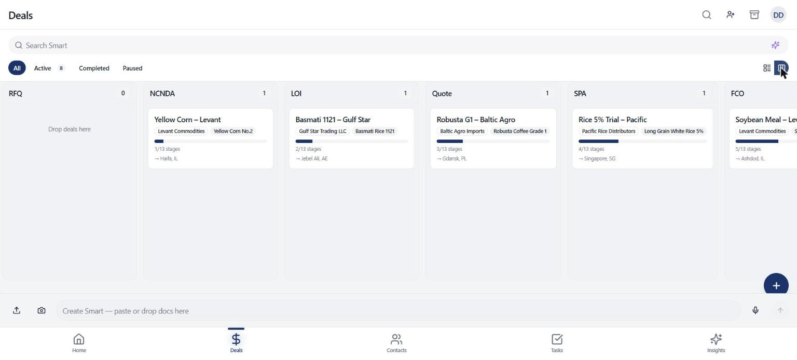
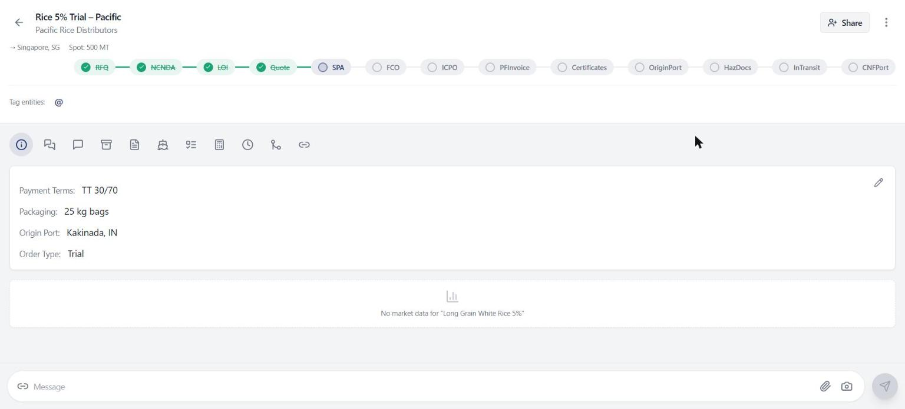
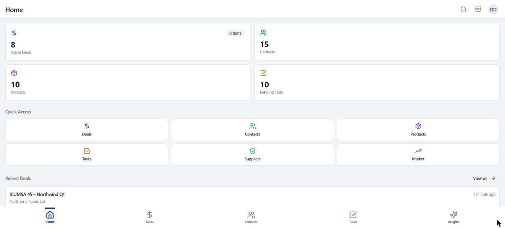
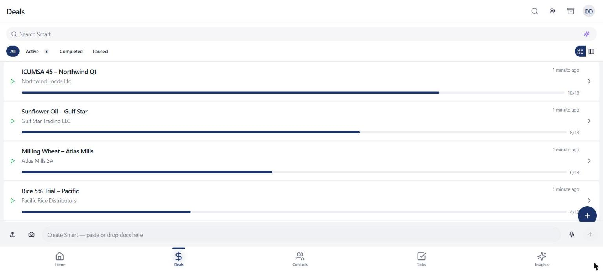
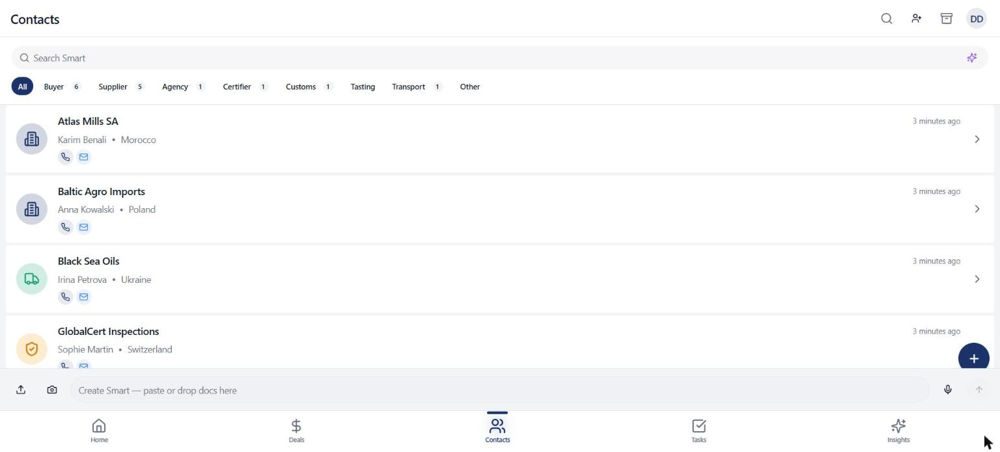
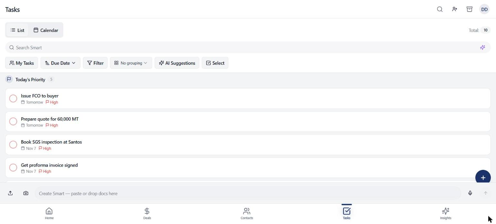
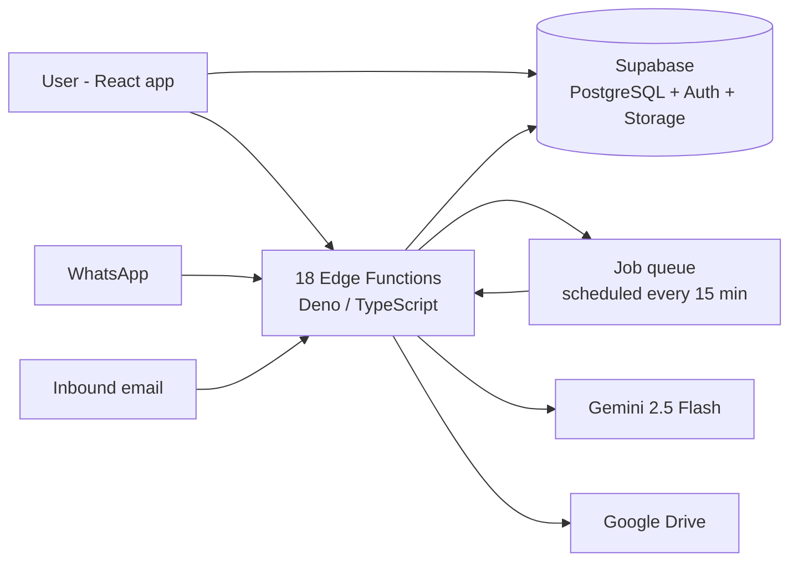

# DealSmart – AI-powered CRM/ERP for trading businesses

DealSmart is a full CRM/ERP for import and commodity trading companies. It tracks deals from first message to shipment, keeps contacts, suppliers and products in one place, and uses AI to turn emails, WhatsApp messages and documents into structured data.

I'm co-founder and developer. It started as a freelance ERP for a client and grew into a product we're developing together.

**How it was built:** AI-first. I used Lovable and Claude to move fast, and I owned the product: the trade workflow, the data model, multi-tenant security, the AI pipelines and the integrations. A real client runs their deals on it today. Now I'm taking it off Lovable to a codebase and infrastructure I run myself (see What's next).

> 🔒 **The source code is private** since this is an active product. Happy to walk through the code and architecture in an interview.

### Deals pipeline – 13 trade stages from RFQ to port of discharge

### Deal page – stage tracker, details, chat, documents, shipments and tasks in tabs

<b>More screenshots</b> (dashboard, deals list, contacts, tasks)

Screenshots use a demo workspace with made-up companies.

## What it does

**Deals and pipeline**
- Deals board (kanban) with custom stages, notes, tasks and documents per deal
- Shipment tracking per deal
- Activity log and "what changed since you last looked" per record

**Contacts, companies, suppliers and products**
- Contacts and companies with custom fields per workspace
- Supplier directory with a trust/verification layer
- Product catalog with custom fields and supplier offers

**AI features** (Gemini 2.5 Flash)
- **Paste a WhatsApp message → get a deal.** The AI pulls out the product, quantity, price and parties and fills in the deal
- **Document processing.** Upload a PDF or Excel file and it extracts entities and offers and links them to the right products
- **Smart import** of contacts and products from messy data
- **AI search** across all deals, contacts and products, including search by image
- **Suggested tasks** and chart insights on the dashboard

**Market intelligence**
- Price trend charts, seasonality, supply/demand and forecasts per commodity

**Integrations**
- WhatsApp webhook (Meta Cloud API) and inbound email, both feeding a processing queue
- Google Drive (OAuth) for documents
- Public share links for tasks, so outside people can view or update without an account

**Multi-tenant and multilingual**
- Workspaces with members and roles, isolated with row-level security
- 6 languages: English, Hebrew, Arabic, Russian, French, Spanish (including RTL)

## Architecture

- **Frontend:** React, TypeScript, Vite, Tailwind CSS, shadcn/ui, React Hook Form, dnd-kit
- **Backend:** Supabase (PostgreSQL, Auth, Storage, Realtime) and 18 Edge Functions
- **Database:** 68 tables across 66 migrations, 229 row-level security policies
- **Jobs:** priority job queue with idempotent processing and a scheduler
- **AI:** Gemini 2.5 Flash with tool calling for structured extraction

## By the numbers

| | |
|---|---|
| Code | ~62,000 lines of TypeScript |
| Commits | 580+ |
| Database | 68 tables, 229 RLS policies |
| Serverless functions | 18 |
| Languages | 6 |

## What's next

- Moving development off Lovable to a standard local workflow (Vite, Git, CI)
- Moving the database and backend to AWS (RDS PostgreSQL, Lambda)
- Real supplier-verification providers in place of the current simulated checks

## Contact

Malka Sobel · malkiesobel@gmail.com · [github.com/MalkieSobel](https://github.com/MalkieSobel)
